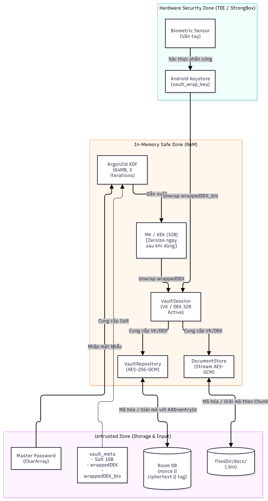

# 🔐 Tài Liệu Thiết Kế Mật Mã (Crypto Design Document)

**Dự án:** Secure Vault Android  
**Phiên bản:** Bản nháp G1 (01/11/2026)  
**Tác giả:** Minh (R5 - Crypto & Keystore Engineer)  
**Người duyệt:** Mạnh4 (R1 - Security Architect)

---

## 1. Kiến Trúc Phân Cấp Khóa (Key Hierarchy)

Hệ thống tuân thủ nguyên tắc **Phân tách khóa (Key Separation)**:
- **Master Key (MK / KEK):** Dẫn xuất từ Master Password thông qua Argon2id KDF. Chỉ dùng để bọc/mở bọc Vault Key, không dùng mã hóa dữ liệu. Xóa khỏi RAM (`fill(0)`) ngay sau khi sử dụng.
- **Vault Key (VK / DEK):** Chuỗi ngẫu nhiên 32 byte (256-bit) sinh bởi `SecureRandom`. Dùng để mã hóa/giải mã cơ sở dữ liệu Room và tài liệu bằng AES-256-GCM.
- **Double Key Wrapping:** VK được lưu trữ dưới 2 bản bọc độc lập:
  - `wrappedDEK`: Bọc bởi MK (AES-256-GCM).
  - `wrappedDEK_bio`: Bọc bởi khóa phần cứng Android Keystore (`vault_wrap_key`).

### Sơ Đồ 3 Phân Vùng Bảo Mật (Security Boundaries)


---

## 2. Khảo Sát Thư Viện KDF: `argon2kt`

Sau quá trình rà soát hệ sinh thái Android/Kotlin, nhóm quyết định lựa chọn thư viện **`argon2kt`**:

* **Kho mã nguồn:** [lambdapioneer/argon2kt](https://github.com/lambdapioneer/argon2kt)
* **Tác giả:** lambdapioneer
* **Tình trạng duy trì:** Hoạt động ổn định, commit cập nhật gần nhất tháng 9/2024. Hỗ trợ đầy đủ Kotlin Multiplatform và Android Native (JNI bọc mã nguồn C chính thức của Argon2 cho `arm64-v8a`, `armeabi-v7a`, `x86_64`).
* **Cấu hình Gradle (Kotlin DSL):**
  ```kotlin
  implementation("com.lambdapioneer.argon2kt:argon2kt:1.6.0")
  ```
* **API thực tế:**
  - Class điều khiển: `com.lambdapioneer.argon2kt.Argon2Kt`
  - Kiểu thuật toán: `Argon2Mode.ARGON2_ID`
  - Hàm thực thi: `argon2Kt.hash(mode, password, salt, tCostInIterations, mCostInKibibyte)`

---

## 3. Đề Xuất Tham Số Argon2id Ban Đầu (RFC 9106)

Dựa trên tiêu chuẩn **RFC 9106** và khuyến nghị cho thiết bị di động (hạn chế pin và RAM), cấu hình ban đầu được đề xuất như sau:

| Tham số | Ký hiệu | Giá trị đề xuất | Ý nghĩa kỹ thuật |
| :--- | :---: | :---: | :--- |
| **Thuật toán** | - | `Argon2id` | Chống cả tấn công kênh kề (Side-channel) và GPU/ASIC brute-force. |
| **Bộ nhớ (Memory Cost)** | `m` | **64 MiB** (65.536 KiB) | Memory-hard: bắt buộc kẻ tấn công phải tốn 64MB RAM cho mỗi lần đoán mật khẩu. |
| **Số vòng lặp (Iterations)** | `t` | **3 vòng** | Tăng độ phức tạp tính toán thời gian. |
| **Độ song song (Parallelism)**| `p` | **1 luồng** | Phù hợp với môi trường di động, tránh chiếm dụng đa nhân gây lag giao diện. |
| **Độ dài khóa đầu ra** | `hashLength`| **32 byte** (256-bit) | Khớp chính xác với kích thước khóa AES-256 (KEK). |
| **Độ dài Salt** | `saltLength`| **16 byte** | Sinh ngẫu nhiên bằng `SecureRandom`, lưu trong `vault_meta`. |

> **Kế hoạch kiểm thử ở Giai đoạn V2:**
> Bộ tham số trên là giá trị ban đầu. Trong giai đoạn V2, nhóm R5 sẽ viết benchmark đo thời gian thực tế trên thiết bị Android thật để đảm bảo thời gian mở kho dao động trong khoảng **200ms - 500ms** (an toàn mà không gây đơ UI / ANR).

---

## 4. Kế Hoạch Triển Khai Kế Tiếp
- **Giai đoạn V1 (02/11 - 15/11):** R2 triển khai khung UI/DB cơ bản. R5 hỗ trợ interface định nghĩa KEK/DEK.
- **Giai đoạn V2 (16/11 - 06/12):** R5 code trực tiếp thuật toán Argon2id, đo benchmark và tích hợp bọc khóa AES-GCM.
