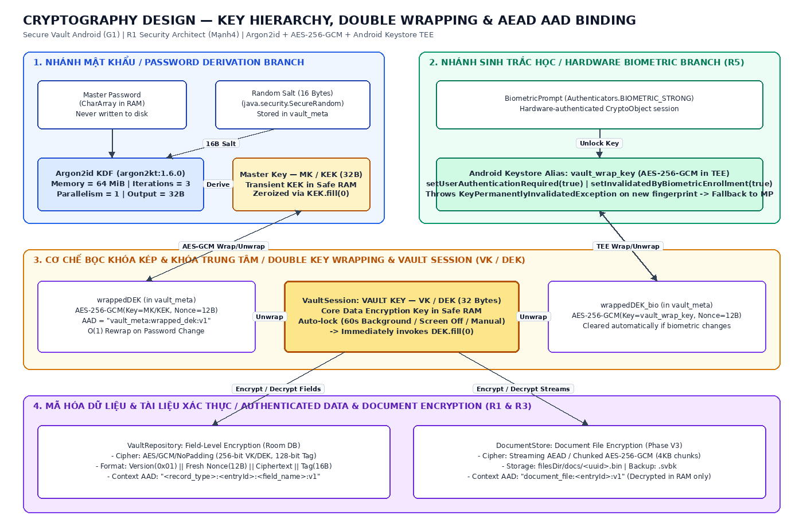
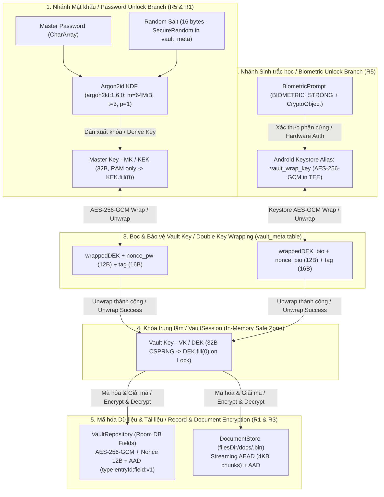

# Thiết kế Mật mã / Cryptography Design — Secure Vault Android

- **Dự án / Project:** Secure Vault Android
- **Phụ trách chính / Lead Author:** R1 – Mạnh4 (Security Architect) *(Đồng bộ hóa với R5 – Minh: Crypto & Keystore Engineer)*
- **Phiên bản / Version:** v0.1 (Bản chốt G1 — Chuẩn bị cho V2 Security Core / Phase G1 Finalized Draft for V2)
- **Ngày cập nhật / Last Updated:** 01/11/2026

---

## 1. Mục tiêu thiết kế & Phân vùng bảo mật / Design Goals & 3 Security Zones

1. **Ba Phân vùng Bảo mật / Three Security Zones (`README.md` & R5 Alignment):**
   - **Untrusted Zone (Vùng không đáng tin cậy):** Gồm dữ liệu đầu vào (`Master Password` dạng `CharArray`, tài liệu từ SAF `content://`, yêu cầu `FillRequest` của `AutofillService`) và dữ liệu lưu trữ trên đĩa (`vault_meta`, Room DB, `filesDir/docs/<uuid>.bin`, file backup `.svbk`).
   - **In-Memory Safe Zone (Vùng an toàn trong bộ nhớ - RAM):** Nơi diễn ra dẫn xuất khóa `Argon2id` (`MK / KEK`), quản lý khóa phiên `VK / DEK` trong `VaultSession`, và thực thi mã hóa/giải mã tại `VaultRepository` & `DocumentStore`.
   - **Hardware Security Zone (Vùng bảo mật phần cứng - TEE):** Android Keystore chứa khóa không thể trích xuất `vault_wrap_key` kết hợp xác thực phần cứng qua `BiometricPrompt` (`CryptoObject`).

2. **Phân tách khóa & Bọc khóa kép / Key Separation & Double Key Wrapping:**
   - **Master Key (`MK` / `KEK` - 32 bytes):** Chỉ dùng để bọc/mở bọc `VK / DEK`, xóa trắng ngay lập tức sau khi dùng (`KEK.fill(0)`).
   - **Vault Key (`VK` / `DEK` - 32 bytes):** Khóa đối xứng trung tâm mã hóa bản ghi Room DB và tài liệu. Được lưu trong bảng `vault_meta` dưới 2 bản bọc độc lập:
     - `wrappedDEK`: Bọc bởi `MK / KEK` (`AES-256-GCM`).
     - `wrappedDEK_bio`: Bọc bởi khóa phần cứng `vault_wrap_key` trong Android Keystore.
   - Khi **đổi Master Password**, chỉ cần bọc lại (`Rewrap`) `VK / DEK` sang `wrappedDEK` mới trong thời gian $O(1)$ mà không cần giải mã lại toàn bộ DB.

3. **Chống tấn công cắt dán & tráo đổi bản ghi / Anti-Tampering & Context Binding (AAD):**
   - Gắn ngữ cảnh **Associated Data (AAD)** chứa `entryId` và tên trường vào mọi thao tác `AES-256-GCM`.

---

## 2. Sơ đồ phân cấp khóa / Key Hierarchy Diagram





---

## 3. Phân công & Đồng bộ hóa Nhiệm vụ Mật mã (R1 $\leftrightarrow$ R5) / Task Synchronization (R1 & R5)

| Hạng mục / Component | Phụ trách chính / Owner | Phối hợp & Duyệt / Reviewer | Đầu ra kỹ thuật thống nhất / Unified Technical Deliverable |
| :--- | :---: | :---: | :--- |
| **Argon2id KDF & Benchmark** | **R5 (Minh)** | **R1 (Mạnh4)** duyệt PR | Thư viện `com.lambdapioneer.argon2kt:argon2kt:1.6.0`, tham số RFC 9106 (`m=64MiB, t=3, p=1`), đo thời gian thực tế đạt `200ms - 500ms`. |
| **Double Key Wrapping (`wrappedDEK`, `wrappedDEK_bio`)** | **R5 (Minh)** & **R1 (Mạnh4)** | **R1 (Mạnh4)** duyệt PR | Bọc/mở bọc `VK / DEK` (32B) bằng `MK / KEK` và `vault_wrap_key`; lưu trong bảng `vault_meta`. |
| **Android Keystore & `BiometricPrompt`** | **R5 (Minh)** | **R1 (Mạnh4)** duyệt PR | Alias `vault_wrap_key`, `setUserAuthenticationRequired(true)`, `setInvalidatedByBiometricEnrollment(true)`, xử lý `KeyPermanentlyInvalidatedException`. |
| **Lõi `AES-256-GCM` + `AAD` & `VaultSession`** | **R1 (Mạnh4)** | **R5 (Minh)** & **R6 (Mạnh3)** test | Mã hóa trường dữ liệu trong `VaultRepository`, sinh Nonce 12B mới mỗi lần ghi, gắn `AAD` chứa `entryId`, xóa `DEK.fill(0)` khi khóa. |
| **Đổi Master Password (`Rewrap DEK`) & Lockout** | **R1 (Mạnh4)** & **R2 (Nam)** | **R6 (Mạnh3)** test | Đổi mật khẩu $O(1)$ không giải mã lại DB; lưu `failed_attempts` và `lockout_until` trong `vault_meta`. |

---

## 4. Chi tiết các thành phần mật mã / Cryptographic Components Specification

### 4.1. Dẫn xuất khóa bằng Argon2id / Key Derivation via Argon2id (`Master Password` $\rightarrow$ `MK / KEK`)
- **Thư viện thống nhất với R5 / Unified Library Coordinate:**
  ```kotlin
  implementation("com.lambdapioneer.argon2kt:argon2kt:1.6.0")
  ```
- **API thực thi / Target API:**
  - Class: `com.lambdapioneer.argon2kt.Argon2Kt`
  - Mode: `Argon2Mode.ARGON2_ID` (v1.3 / RFC 9106)
  - Method: `argon2Kt.hash(mode, password, salt, tCostInIterations, mCostInKibibyte)`
- **Tham số đề xuất ban đầu / Initial Parameters (RFC 9106):**
  - `mCostInKibibyte` (`m`): **65536 KiB (64 MiB)** — Memory-hard chống GPU/ASIC.
  - `tCostInIterations` (`t`): **3 vòng lặp / 3 passes**.
  - `parallelism` (`p`): **1 luồng / 1 lane** — Tối ưu cho CPU di động, tránh gây lag UI.
  - `hashLength`: **32 bytes (256-bit)** — Kích thước của `MK / KEK`.
  - `salt`: **16 bytes (128-bit)** — Sinh từ `java.security.SecureRandom`, lưu trong bảng `vault_meta`.
  - *Lưu ý V2:* Đo benchmark thực tế trên máy thật ở mục `5.2` để đảm bảo thời gian mở khóa nằm trong ngưỡng **`200ms – 500ms`**.

### 4.2. Sinh, Bọc khóa kép và Quản lý phiên (`VaultSession`) / VK Generation, Double Wrapping & Session Management
- **Khởi tạo Vault lần đầu / Initial Vault Setup:**
  1. **VI:** Sinh `Vault Key (VK / DEK)` độ dài **32 bytes (256-bit)** bằng `SecureRandom`.
     **EN:** Generate a **32-byte (256-bit)** `Vault Key (VK / DEK)` using `SecureRandom`.
  2. **VI:** Sinh `salt` (16 bytes), chạy `Argon2id` để dẫn xuất `MK / KEK` (32 bytes) từ `Master Password` (`CharArray`).
     **EN:** Generate a 16-byte `salt` and run `Argon2id` to derive the 32-byte `MK / KEK` from the `Master Password` (`CharArray`).
  3. **VI:** Dùng `MK / KEK` bọc `VK / DEK` qua `AES-256-GCM` với `nonce_pw` (12 bytes) và `AAD = "vault_meta:wrapped_dek:v1"` $\rightarrow$ tạo thành `wrappedDEK`.
     **EN:** Wrap `VK / DEK` under `MK / KEK` using `AES-256-GCM` with a 12-byte `nonce_pw` and `AAD = "vault_meta:wrapped_dek:v1"` $\rightarrow$ producing `wrappedDEK`.
  4. **VI:** Lưu `wrappedDEK`, `salt` và tham số KDF vào bảng `vault_meta`, sau đó gọi `KEK.fill(0)` và xóa trắng `CharArray` mật khẩu.
     **EN:** Persist `wrappedDEK`, `salt`, and KDF parameters in `vault_meta`, then immediately invoke `KEK.fill(0)` and clear the password `CharArray`.

- **Quản lý phiên `VaultSession` & Tự động khóa / `VaultSession` & Auto-Lock Lifecycle:**
  - **VI:** `VaultSession` giữ `VK / DEK` trong `In-Memory Safe Zone` khi kho đang mở. Kho sẽ lập tức chuyển sang trạng thái khóa và gọi `DEK.fill(0)` khi:
    1. Người dùng chủ động bấm khóa Vault.
    2. Màn hình thiết bị tắt (Screen off).
    3. Ứng dụng chạy dưới nền quá thời gian quy định (60 giây theo `README.md` / cấu hình tối đa 5 phút không thao tác ở V4).
  - **EN:** `VaultSession` holds `VK / DEK` in the `In-Memory Safe Zone` while unlocked. It immediately transitions to locked state and invokes `DEK.fill(0)` when:
    1. The user manually locks the Vault.
    2. The device screen turns off.
    3. The app remains in the background beyond the timeout threshold (60s in `README.md` / up to 5m inactivity in V4).

### 4.3. Nhánh Android Keystore & BiometricPrompt / Android Keystore & Biometric Unlock Branch
- **Cấu hình khóa trong `AndroidKeyStore` / `KeyGenParameterSpec` Configuration:**
  - `keystoreAlias`: **`"vault_wrap_key"`** (đồng bộ với `README.md` và nhánh R5).
  - `Algorithm`: `KeyProperties.KEY_ALGORITHM_AES`, **256-bit**, `BLOCK_MODE_GCM`, `ENCRYPTION_PADDING_NONE`.
  - **VI:** Bắt buộc xác thực sinh trắc học mạnh cho mỗi lần sử dụng (`CryptoObject`):
    **EN:** Require strong biometric authentication per operation via `BiometricPrompt.CryptoObject`:
    - `setUserAuthenticationRequired(true)`
    - `setInvalidatedByBiometricEnrollment(true)`
- **Xử lý khi đổi vân tay / Handling `KeyPermanentlyInvalidatedException`:**
  - **VI:** Khi có vân tay mới đăng ký trên thiết bị, khóa `vault_wrap_key` bị vô hiệu hóa vĩnh viễn và ném `KeyPermanentlyInvalidatedException`. Ứng dụng bắt ngoại lệ này, xóa `wrappedDEK_bio` trong `vault_meta`, xóa khóa `vault_wrap_key` trong Keystore và yêu cầu người dùng mở khóa bằng **Master Password** trước khi thiết lập lại vân tay.
  - **EN:** When a new fingerprint is enrolled on the device, `vault_wrap_key` is permanently invalidated and throws `KeyPermanentlyInvalidatedException`. The app catches this exception, removes `wrappedDEK_bio` from `vault_meta`, deletes the Keystore alias, and requires **Master Password** authentication before re-enrolling biometrics.

### 4.4. Quy trình Đổi Master Password (`Rewrap DEK`) / $O(1)$ Master Password Rotation
1. **VI:** Nhập **Mật khẩu hiện tại** $\rightarrow$ dẫn xuất `KEK_old` $\rightarrow$ giải bọc `wrappedDEK` để lấy `VK / DEK`.
   **EN:** Enter **Current Password** $\rightarrow$ derive `KEK_old` $\rightarrow$ unwrap `wrappedDEK` to recover `VK / DEK`.
2. **VI:** Sinh `salt_new` (16 bytes) $\rightarrow$ dẫn xuất `KEK_new` từ **Mật khẩu mới** qua `Argon2id`.
   **EN:** Generate a fresh 16-byte `salt_new` $\rightarrow$ derive `KEK_new` from the **New Password** via `Argon2id`.
3. **VI:** Sinh `nonce_new` (12 bytes) $\rightarrow$ dùng `KEK_new` bọc lại `VK / DEK` thành `wrappedDEK` mới và cập nhật vào bảng `vault_meta` trong 1 transaction.
   **EN:** Generate a fresh 12-byte `nonce_new` $\rightarrow$ re-wrap `VK / DEK` under `KEK_new` and atomically update `vault_meta`.
4. **VI:** Gọi `KEK_old.fill(0)`, `KEK_new.fill(0)` và xóa trắng các mảng `CharArray` mật khẩu.
   **EN:** Zeroize `KEK_old.fill(0)`, `KEK_new.fill(0)`, and all password `CharArray` buffers.

---

## 5. Mã hóa Bản ghi (`VaultRepository`) & Tài liệu (`DocumentStore`) / Record & Document Encryption

### 5.1. Thuật toán, Quản lý Nonce & Định dạng Blob / Cipher Suite, Nonce Rules & Blob Format
- **Thuật toán / Algorithm:** `AES/GCM/NoPadding`, khóa `VK / DEK` (256-bit), Authentication Tag **128-bit (16 bytes)**.
- **Quy tắc Nonce (IV) / Nonce Rules:**
  - **VI:** Mỗi lần mã hóa một trường hoặc một khối (chunk) tài liệu bắt buộc sinh mới **12 bytes (96-bit) Nonce** từ `SecureRandom`. **Tuyệt đối không tái sử dụng `(DEK, Nonce)`**.
  - **EN:** Every field or chunk encryption operation must generate a fresh **12-byte (96-bit) Nonce** via `SecureRandom`. **Never reuse a `(DEK, Nonce)` pair.**
- **Định dạng lưu trữ / Encrypted Blob Wire Format:**
  $$\text{Blob} = \text{Version (1B: 0x01)} \parallel \text{Nonce (12B)} \parallel \text{Ciphertext} \parallel \text{GCM Tag (16B)}$$

### 5.2. Cấu trúc Associated Data (AAD) gắn `entryId` / Context-Bound AAD Format
- **VI:** Đồng bộ với `README.md` (sử dụng `entryId` làm AAD chống tráo đổi bản mã giữa các dòng/cột trong Room DB):
- **EN:** Aligned with `README.md` (binding `entryId` into AAD to prevent ciphertext swapping across SQLite rows/columns):

```text
AAD = "<record_type>:<entryId>:<field_name>:v1"
```

- **Ví dụ / Examples:**
  - Credential Password: `AAD = "credential:550e8400-e29b-41d4-a716-446655440000:password:v1"`
  - Identity Document Number: `AAD = "document:7c9e6679-7425-40de-944b-e07fc1f90ae7:doc_number:v1"`
  - Document Binary File (`filesDir/docs/<uuid>.bin`): `AAD = "document_file:<entryId>:v1"`

### 5.3. Mã hóa Tài liệu trong `DocumentStore` (Phase V3) & Bản sao lưu `.svbk`
- **VI:** Tài liệu nhạy cảm (ảnh CCCD, hộ chiếu, PDF) nhập qua SAF (`content://`) được xử lý theo luồng (Streaming AEAD / Chunked AES-GCM) và lưu tại `filesDir/docs/<uuid>.bin`. Khi xem chỉ giải mã trên RAM, không tạo file tạm chưa mã hóa trên đĩa.
- **EN:** Sensitive documents (ID scans, passports, PDFs) ingested via SAF (`content://`) are encrypted via Streaming AEAD / Chunked AES-GCM into `filesDir/docs/<uuid>.bin`. Viewing decrypts streams strictly in RAM without creating plaintext temp files on disk.

---

## 6. Xử lý lỗi, Vệ sinh bộ nhớ & Chống Brute-force / Error Handling, Memory Hygiene & Lockout

1. **Vệ sinh bộ nhớ khả biến / RAM Zeroization (`fill(0)`):**
   - **VI:** Luôn xóa `CharArray` mật khẩu, `KEK.fill(0)` ngay sau khi mở khóa, và `DEK.fill(0)` khi khóa `VaultSession`. Ghi nhận rõ giới hạn của JVM/ART Garbage Collector trong báo cáo bảo mật.
   - **EN:** Always zeroize password `CharArray` buffers, invoke `KEK.fill(0)` immediately after key unwrapping, and invoke `DEK.fill(0)` when locking `VaultSession`, while documenting JVM/ART GC limitations.
2. **Xử lý ngoại lệ mật mã an toàn / Safe Crypto Exception Handling:**
   - **VI:** Mọi lỗi xác thực thẻ GCM (`AEADBadTagException`), mật khẩu sai, hoặc file `.bin`/`.svbk` bị sửa đổi đều được bắt tại tầng `security/` và trả về lỗi định danh chung; tuyệt đối không ghi khóa hay dữ liệu nhạy cảm ra `Logcat`.
   - **EN:** All GCM tag verification failures (`AEADBadTagException`), wrong passwords, or tampered `.bin`/`.svbk` files are caught in the `security/` layer and mapped to generic domain errors; never log sensitive data to `Logcat`.
3. **Chính sách Lockout & Delay lũy tiến trong `vault_meta` / Persistent Lockout Policy:**
   - Attempts 1–4: Allow immediate retry (Cho phép thử lại ngay).
   - Attempt 5: Lockout for **30 seconds** (Khóa 30 giây).
   - Attempt 6: Lockout for **1 minute** (Khóa 1 phút).
   - Attempt 7: Lockout for **5 minutes** (Khóa 5 phút).
   - Attempt 8+: Lockout for **15 minutes** (Khóa 15 phút).
