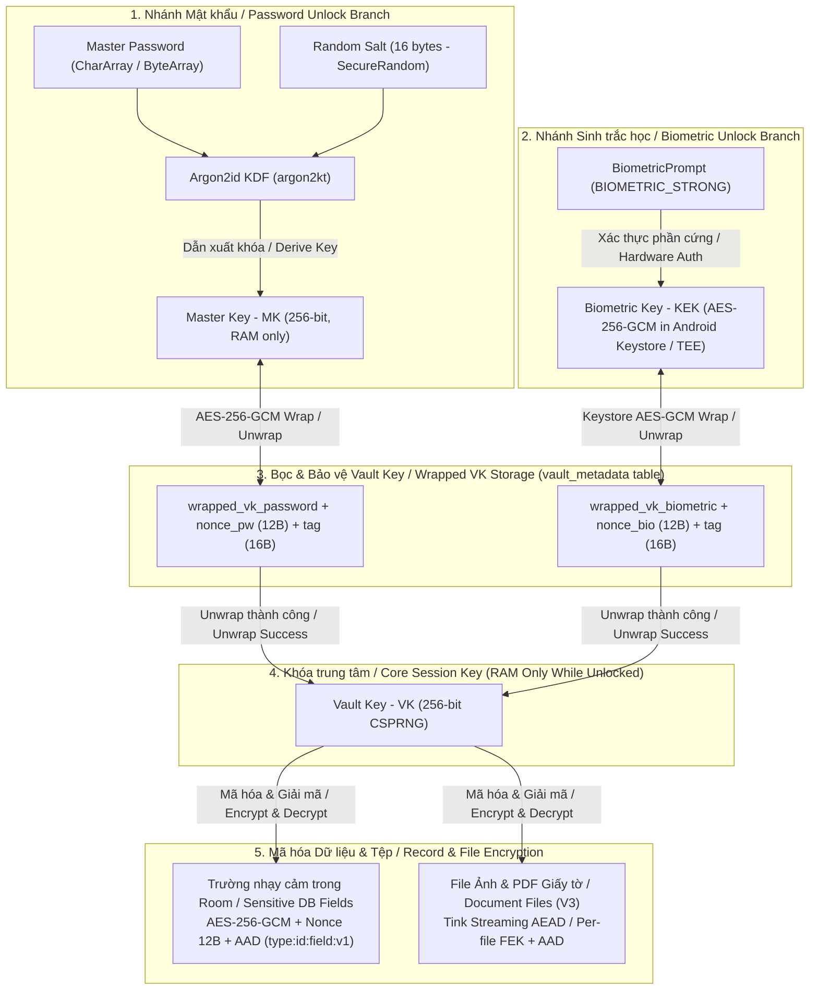

# Thiết kế Mật mã / Cryptography Design — Secure Vault Android

- **Dự án / Project:** Secure Vault Android
- **Phụ trách chính / Lead Authors:** R1 – Mạnh4 (Security Architect) & R5 – Minh (Crypto & Keystore Engineer)
- **Phiên bản / Version:** v0.1 (Bản nháp G1 — Chuẩn bị cho V2 Security Core / Phase G1 Draft for V2)
- **Ngày cập nhật / Last Updated:** 01/11/2026

---

## 1. Mục tiêu thiết kế / Design Goals

1. **Bảo mật dữ liệu nghỉ / Data-at-Rest Confidentiality & Integrity:**
   - **VI:** Mọi thông tin nhạy cảm trong SQLite (Room) và file đính kèm (ảnh/PDF giấy tờ) đều được mã hóa xác thực (**AEAD**). Kẻ tấn công kéo toàn bộ thư mục `/data/data/...` qua `adb` không thể đọc hoặc sửa đổi trái phép dữ liệu.
   - **EN:** All sensitive records in SQLite (Room) and attached files (ID images/PDFs) are protected using Authenticated Encryption with Associated Data (**AEAD**). An attacker extracting `/data/data/...` via `adb` cannot read or undetectedly modify any sensitive content.

2. **Độc lập giữa khóa dữ liệu và mật khẩu người dùng / Decoupling Data Encryption Keys from User Credentials:**
   - **VI:** Dữ liệu được mã hóa bằng **Vault Key (VK)** ngẫu nhiên thay vì mã hóa trực tiếp bằng khóa dẫn xuất từ mật khẩu. Nhờ đó:
     - Có thể mở khóa cùng một `VK` bằng nhiều phương thức (**Master Password** hoặc **Sinh trắc học / Android Keystore**).
     - Khi **đổi Master Password**, chỉ cần bọc lại (rewrap) `VK` trong thời gian $O(1)$ mà không phải giải mã và mã hóa lại toàn bộ cơ sở dữ liệu.
   - **EN:** Application data is encrypted with a randomly generated **Vault Key (VK)** rather than directly with a password-derived key. Consequently:
     - The same `VK` can be unlocked via multiple factors (**Master Password** or **Biometrics / Android Keystore**).
     - **Master Password rotation** only requires re-wrapping `VK` in $O(1)$ time without re-encrypting the underlying database or files.

3. **Chống tấn công cắt dán & tráo đổi bản ghi / Anti-Tampering & Context Binding:**
   - **VI:** Sử dụng **Associated Data (AAD)** gắn chặt bản mã với định danh bản ghi và tên trường dữ liệu.
   - **EN:** Enforces cryptographic context binding via **Associated Data (AAD)** tying every ciphertext blob to its exact record type, record UUID, and field name.

---

## 2. Sơ đồ phân cấp khóa / Key Hierarchy Diagram



---

## 3. Chi tiết các thành phần mật mã / Cryptographic Components Specification

### 3.1. Dẫn xuất khóa bằng Argon2id / Key Derivation via Argon2id (`Master Password` $\rightarrow$ `Master Key`)
- **Thư viện sử dụng / Library:**
  - **VI:** `argon2kt` (được R5 khảo sát phiên bản stable và API thực tế trong giai đoạn G1).
  - **EN:** `argon2kt` (stable version and exact artifact coordinates verified by R5 during Phase G1).
- **Biến thể / Variant:**
  - **VI:** `Argon2id` (phiên bản `0x13` / v1.3) — kết hợp khả năng kháng tấn công kênh kề (side-channel) của Argon2i và kháng phần cứng chuyên dụng (GPU/ASIC) của Argon2d.
  - **EN:** `Argon2id` (version `0x13` / v1.3) — combining the side-channel resistance of Argon2i with the GPU/ASIC cracking resistance of Argon2d.
- **Tham số đề xuất ban đầu / Initial Proposed Parameters:**
  - **VI:** *Sẽ đo thực tế trên thiết bị thật ở mục 5.2 giai đoạn V2 để thời gian mở khóa đạt khoảng `300ms – 500ms` mà không gây giật UI:*
  - **EN:** *To be benchmarked on physical target devices in Phase V2 (Task 5.2) targeting a `300ms – 500ms` derivation latency off the main thread:*
    - `salt`: **16 bytes (128-bit)** generated via `java.security.SecureRandom`.
    - `hashLength` (`MK` output size): **32 bytes (256-bit)**.
    - `memoryCost`: **65536 KiB (64 MB)** *(or tuned to 32768 KiB on lower-tier devices)*.
    - `iterations` (`t_cost`): **3 passes**.
    - `parallelism` (`p`): **2 lanes**.
- **Lưu trữ tham số / Parameter Persistence:**
  - **VI:** Các tham số `argon2_memory`, `argon2_iterations`, `argon2_parallelism` và `salt` được lưu kèm trong bảng `vault_metadata` để hỗ trợ nâng cấp tham số về sau.
  - **EN:** `argon2_memory`, `argon2_iterations`, `argon2_parallelism`, and `salt` are stored alongside the wrapped key in `vault_metadata` to support future parameter upgrades.

### 3.2. Sinh và Bọc Vault Key / Vault Key (VK) Generation & Wrapping
- **Khởi tạo Vault lần đầu / Initial Vault Setup:**
  1. **VI:** Sinh `Vault Key (VK)` độ dài **32 bytes (256-bit)** bằng `SecureRandom`.
     **EN:** Generate a **32-byte (256-bit)** `Vault Key (VK)` using `SecureRandom`.
  2. **VI:** Sinh `salt` (16 bytes), chạy `Argon2id(MasterPassword, salt)` để thu được `Master Key (MK)` (32 bytes).
     **EN:** Generate a 16-byte `salt` and run `Argon2id(MasterPassword, salt)` to derive the 32-byte `Master Key (MK)`.
  3. **VI:** Dùng `MK` mã hóa `VK` bằng thuật toán `AES-256-GCM` với `nonce_pw` (12 bytes ngẫu nhiên) và `AAD = "vault_key_wrap_v1"`.
     **EN:** Encrypt `VK` under `MK` using `AES-256-GCM` with a random 12-byte `nonce_pw` and `AAD = "vault_key_wrap_v1"`.
  4. **VI:** Lưu `wrapped_vk_password`, `nonce_pw`, `salt` và các tham số Argon2id vào bảng `vault_metadata`.
     **EN:** Persist `wrapped_vk_password`, `nonce_pw`, `salt`, and Argon2id parameters into the `vault_metadata` table.
  5. **VI:** Xóa trắng (`fill(0)`) mảng byte của `MasterPassword` và `MK` trong RAM.
     **EN:** Zeroize (`fill(0)`) the `MasterPassword` and `MK` buffers in RAM immediately.

- **Mở khóa bằng Master Password / Unlocking with Master Password:**
  1. **VI:** Kiểm tra `lockout_until` trong `vault_metadata`. Nếu đang bị khóa tạm thời, từ chối ngay.
     **EN:** Check `lockout_until` in `vault_metadata`. If currently locked out, reject immediately.
  2. **VI:** Đọc `salt` và tham số Argon2id từ DB, dẫn xuất lại `MK`.
     **EN:** Read `salt` and Argon2id parameters from the DB and re-derive `MK`.
  3. **VI:** Giải mã `wrapped_vk_password` với `AAD = "vault_key_wrap_v1"`.
     **EN:** Decrypt `wrapped_vk_password` using `MK` and `AAD = "vault_key_wrap_v1"`.
  4. **VI:** Nếu giải mã thành công: nạp `VK` vào bộ nhớ phiên (RAM), đặt lại `failed_attempts = 0`.
     **EN:** On success: load `VK` into active session memory (RAM) and reset `failed_attempts = 0`.
  5. **VI:** Nếu ném `AEADBadTagException` (sai mật khẩu hoặc dữ liệu bị sửa): tăng `failed_attempts`, tính thời gian lockout lũy tiến và cập nhật vào DB.
     **EN:** On `AEADBadTagException` (wrong password or tampered blob): increment `failed_attempts`, compute the progressive lockout timestamp, and persist to DB.

### 3.3. Nhánh Android Keystore & BiometricPrompt / Android Keystore & Biometric Unlock Branch
- **Cấu hình khóa trong `AndroidKeyStore` / `KeyGenParameterSpec` Configuration:**
  - `keystoreAlias`: `"secure_vault_biometric_kek"`
  - `Algorithm`: `KeyProperties.KEY_ALGORITHM_AES`, **256-bit**.
  - `BlockMode / Padding`: `BLOCK_MODE_GCM`, `ENCRYPTION_PADDING_NONE`.
  - **VI:** Bắt buộc xác thực sinh trắc học mạnh cho mỗi lần sử dụng khóa:
    **EN:** Require strong biometric authentication for every cryptographic operation:
    - `setUserAuthenticationRequired(true)`
    - `BiometricPrompt.PromptInfo` configured with `Authenticators.BIOMETRIC_STRONG`.
  - **VI:** Vô hiệu hóa khóa khi thay đổi dữ liệu sinh trắc học trên máy:
    **EN:** Invalidate key material upon new biometric enrollment:
    - `setInvalidatedByBiometricEnrollment(true)`
- **Xử lý khi đổi vân tay / Handling `KeyPermanentlyInvalidatedException`:**
  - **VI:** Khi người dùng thêm vân tay mới vào hệ điều hành, khóa trong Keystore bị vô hiệu hóa vĩnh viễn. Ứng dụng bắt ngoại lệ `KeyPermanentlyInvalidatedException`, xóa `wrapped_vk_biometric` trong DB, xóa khóa cũ trong Keystore và yêu cầu người dùng đăng nhập lại bằng **Master Password** trước khi bật lại sinh trắc học.
  - **EN:** When a new fingerprint is enrolled at the OS level, the Keystore key is permanently invalidated. The app catches `KeyPermanentlyInvalidatedException`, deletes `wrapped_vk_biometric` from the DB, removes the invalidated Keystore alias, and requires the user to authenticate with their **Master Password** before re-enabling biometric unlock.

### 3.4. Quy trình Đổi Master Password / Master Password Rotation (Rewrap VK)
1. **VI:** Người dùng nhập **Mật khẩu hiện tại** $\rightarrow$ dẫn xuất `MK_old` $\rightarrow$ mở bọc để lấy `VK` (xác minh mật khẩu cũ đúng).
   **EN:** User enters **Current Password** $\rightarrow$ derive `MK_old` $\rightarrow$ unwrap `VK` (verifying current password authenticity).
2. **VI:** Sinh `salt_new` (16 bytes mới) $\rightarrow$ dẫn xuất `MK_new` từ **Mật khẩu mới** qua Argon2id.
   **EN:** Generate a fresh 16-byte `salt_new` $\rightarrow$ derive `MK_new` from the **New Password** via Argon2id.
3. **VI:** Sinh `nonce_pw_new` (12 bytes mới) $\rightarrow$ dùng `MK_new` bọc lại `VK` thành `wrapped_vk_password_new`.
   **EN:** Generate a fresh 12-byte `nonce_pw_new` $\rightarrow$ wrap `VK` under `MK_new` to produce `wrapped_vk_password_new`.
4. **VI:** Cập nhật `salt_new`, `nonce_pw_new`, `wrapped_vk_password_new` vào bảng `vault_metadata` trong một transaction.
   **EN:** Atomically update `salt_new`, `nonce_pw_new`, and `wrapped_vk_password_new` in `vault_metadata` within a single DB transaction.
5. **VI:** Xóa trắng (`fill(0)`) toàn bộ `MK_old`, `MK_new`, mật khẩu cũ và mới trong RAM.
   **EN:** Zeroize (`fill(0)`) `MK_old`, `MK_new`, and both old and new password buffers in RAM.

---

## 4. Mã hóa Bản ghi & Associated Data / Field-level Encryption & Associated Data (AAD)

### 4.1. Thuật toán & Quản lý Nonce / Cipher Suite & Nonce Management
- **Thuật toán / Algorithm:** `AES/GCM/NoPadding`, 256-bit key (`VK`), **128-bit (16-byte)** Authentication Tag.
- **Quy tắc Nonce (IV) / Nonce (IV) Rules:**
  - **VI:** Độ dài chuẩn GCM là **12 bytes (96-bit)**. Mỗi lần mã hóa một trường (khi tạo mới **hoặc** khi cập nhật), bắt buộc gọi `SecureRandom.nextBytes(12)` để sinh Nonce hoàn toàn mới. **Tuyệt đối không tái sử dụng Nonce** với cùng một `VK`.
  - **EN:** Standard GCM nonce length is **12 bytes (96-bit)**. Every field encryption operation (on insert **or** update) must generate a fresh 12-byte nonce via `SecureRandom.nextBytes(12)`. **Never reuse a `(VK, Nonce)` pair.**
- **Định dạng lưu trữ trường mã hóa / Encrypted Field Wire Format:**
  $$\text{EncryptedBlob} = \text{Version (1 byte: 0x01)} \parallel \text{Nonce (12 bytes)} \parallel \text{Ciphertext} \parallel \text{GCM Tag (16 bytes)}$$

### 4.2. Cấu trúc Associated Data / Associated Data (AAD) Format
- **VI:** Để ngăn chặn kẻ tấn công có quyền truy cập file SQLite tráo đổi bản mã giữa các dòng hoặc các cột, mọi thao tác mã hóa/giải mã trường đều gắn **AAD** được mã hóa UTF-8:
- **EN:** To prevent an attacker with SQLite file access from swapping ciphertexts across rows or columns (cut-and-paste attacks), every field encryption/decryption binds UTF-8 encoded **AAD**:

```text
AAD = "<record_type>:<record_id>:<field_name>:v1"
```

- **Ví dụ thực tế / Concrete Examples:**
  - Credential Password (`record_id = 550e8400-e29b-41d4-a716-446655440000`):
    `AAD = "credential:550e8400-e29b-41d4-a716-446655440000:password:v1"`
  - Identity Document Number (`record_id = 7c9e6679-7425-40de-944b-e07fc1f90ae7`):
    `AAD = "document:7c9e6679-7425-40de-944b-e07fc1f90ae7:doc_number:v1"`
- **VI:** Khi giải mã, nếu bản mã bị di chuyển sang dòng khác hoặc cột khác, `AAD` tái tạo sẽ không khớp và phép kiểm tra GCM Tag sẽ thất bại ngay lập tức (`AEADBadTagException`).
- **EN:** During decryption, if a ciphertext blob was moved to another row or column, the reconstructed `AAD` will mismatch and GCM tag verification will immediately fail (`AEADBadTagException`).

---

## 5. Mã hóa File Ảnh & PDF Giấy tờ / Document Image & PDF File Encryption (Phase V3)

1. **Mã hóa theo luồng / Streaming AEAD Encryption:**
   - **VI:** Không dùng AES-GCM một khối duy nhất cho file lớn để tránh tràn RAM (`OutOfMemoryError`). Sử dụng **Google Tink Streaming AEAD** (`AES256_GCM_HKDF_4KB`) với khóa dẫn xuất hoặc Per-file Key được bọc bởi `VK`, gắn `AAD = "document_file:<document_id>:v1"`.
   - **EN:** Avoid single-shot AES-GCM on large files to prevent `OutOfMemoryError`. Use **Google Tink Streaming AEAD** (`AES256_GCM_HKDF_4KB`) with a subkey or per-file Data Encryption Key wrapped by `VK`, bound to `AAD = "document_file:<document_id>:v1"`.
2. **Ẩn danh tên file / Filename Anonymization:**
   - **VI:** File mã hóa lưu trong `context.filesDir/vault_files/` với **tên file là UUID ngẫu nhiên** (không giữ tên gốc hay đuôi `.jpg`/`.pdf`). Tên gốc và MIME type được mã hóa trong Room DB.
   - **EN:** Encrypted files are stored under `context.filesDir/vault_files/` using **random UUID filenames** (stripping original filenames and `.jpg`/`.pdf` extensions). Original filenames and MIME types are encrypted inside Room DB.
3. **Giải mã chỉ trong RAM / In-Memory Decryption Only:**
   - **VI:** Khi người dùng mở xem ảnh/PDF, luồng giải mã chỉ đọc ra `ByteArray` / `Bitmap` trong RAM, tuyệt đối không ghi file tạm chưa mã hóa xuống đĩa.
   - **EN:** When viewing an image or PDF, the decrypted stream is held strictly in RAM (`ByteArray` / `Bitmap`) and never written to temporary plaintext files on disk.

---

## 6. Xử lý lỗi & Vệ sinh bộ nhớ / Error Handling & Memory Hygiene

1. **Vệ sinh bộ nhớ khả biến / RAM Zeroization:**
   - **VI:** Không truyền Master Password dưới dạng `kotlin.String` ở tầng Crypto (do `String` trên JVM là bất biến). Sử dụng `CharArray` cho mật khẩu và `ByteArray` cho `MK`, `VK`, dữ liệu giải mã. Luôn dùng `try { ... } finally { array.fill(0) }` để xóa trắng sau khi dùng và khi **Auto-lock**.
   - **EN:** Never pass the Master Password as an immutable `kotlin.String` inside the Crypto layer. Use `CharArray` for passwords and `ByteArray` for `MK`, `VK`, and plaintext buffers. Always wrap operations in `try { ... } finally { array.fill(0) }` and zeroize `VK` upon **Auto-lock**.
2. **Xử lý ngoại lệ mật mã an toàn / Safe Crypto Exception Handling:**
   - **VI:** Mọi lỗi giải mã (`AEADBadTagException`, `GeneralSecurityException`, file hỏng) được bắt tại tầng `security/` và trả về kết quả định danh (`CryptoResult.AuthFailed`, `CryptoResult.TamperedOrCorrupted`). **Tuyệt đối không ghi log** khóa, mật khẩu, plaintext hoặc chi tiết exception ra `Logcat`.
   - **EN:** All cryptographic exceptions (`AEADBadTagException`, `GeneralSecurityException`, truncated files) are caught inside the `security/` layer and mapped to domain-safe sealed results (`CryptoResult.AuthFailed`, `CryptoResult.TamperedOrCorrupted`). **Never log** keys, passwords, plaintext, or raw cipher stack traces to `Logcat`.
3. **Chống Brute-force / Lockout & Progressive Delay Policy:**
   - **VI:** Lưu `failed_attempts` và `lockout_until` trong bảng `vault_metadata`:
   - **EN:** Persist `failed_attempts` and `lockout_until` in the `vault_metadata` table:
     - Attempts 1–4: Allow immediate retry (Cho phép thử lại ngay).
     - Attempt 5: Lockout for **30 seconds** (Khóa 30 giây).
     - Attempt 6: Lockout for **1 minute** (Khóa 1 phút).
     - Attempt 7: Lockout for **5 minutes** (Khóa 5 phút).
     - Attempt 8+: Lockout for **15 minutes** (Khóa 15 phút).
