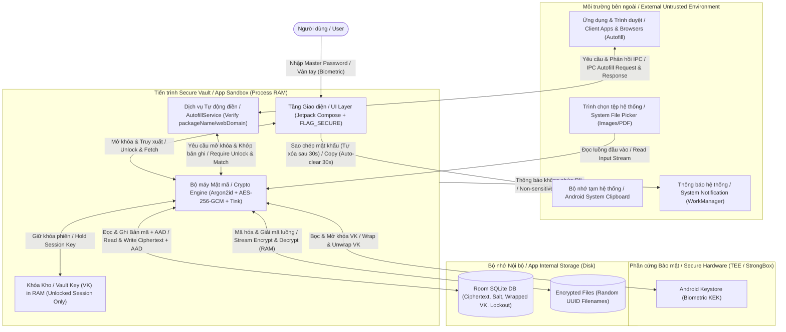

# Mô hình Mối đe dọa / Threat Model — Secure Vault Android

- **Dự án / Project:** Secure Vault Android
- **Phụ trách chính / Lead Author:** R1 – Mạnh4 (Security Architect)
- **Phản biện / Reviewer:** R6 – Mạnh3 (QA / Security Tester)
- **Phiên bản / Version:** v0.1 (Giai đoạn G1 / Phase G1)
- **Ngày cập nhật / Last Updated:** 01/11/2026

---

## 1. Tổng quan hệ thống & Kiến trúc dữ liệu / System Overview & Data Architecture

**VI:** **Secure Vault Android** là ứng dụng quản lý mật khẩu (Credentials) và lưu trữ giấy tờ cá nhân nhạy cảm (CCCD, hộ chiếu, bằng lái, BHYT...) hoạt động hoàn toàn **ngoại tuyến (offline)** (không có quyền `INTERNET`). Toàn bộ dữ liệu nhạy cảm được mã hóa xác thực (`AEAD`) trước khi ghi xuống bộ nhớ thiết bị.

**EN:** **Secure Vault Android** is a password manager (Credentials) and sensitive personal document vault (National ID, Passport, Driver's License, Health Insurance...) operating **100% offline** (no `INTERNET` permission). All sensitive data is encrypted using Authenticated Encryption with Associated Data (`AEAD`) prior to being written to device storage.

---

## 2. Tài sản cần bảo vệ / Assets to Protect

| Mã / ID | Tài sản / Asset | Mô tả chi tiết / Detailed Description (VI / EN) | Mức độ / Criticality | Vị trí tồn tại / Location (VI / EN) |
| :--- | :--- | :--- | :---: | :--- |
| **A-01** | **Master Password** *(Mật khẩu chính)* | **VI:** Mật khẩu gốc của người dùng, không bao giờ được lưu xuống đĩa. **EN:** The user's root secret password; never persisted to disk. | **Tối mật / Critical** | **VI:** Chỉ nằm tạm thời trong RAM (`CharArray`/`ByteArray`) lúc xác thực. **EN:** Transient in RAM (`CharArray`/`ByteArray`) during authentication only. |
| **A-02** | **Master Key (MK)** *(Khóa dẫn xuất)* | **VI:** Khóa 256-bit dẫn xuất từ Master Password qua Argon2id, dùng để bọc/mở khóa Vault Key. **EN:** 256-bit key derived from Master Password via Argon2id, used to wrap/unwrap the Vault Key. | **Tối mật / Critical** | **VI:** Chỉ nằm tạm thời trong RAM khi mở khóa hoặc đổi mật khẩu. **EN:** Transient in RAM during vault unlock or password rotation only. |
| **A-03** | **Vault Key (VK)** *(Khóa trung tâm)* | **VI:** Khóa đối xứng 256-bit trung tâm dùng để mã hóa các bản ghi trong DB và khóa file. **EN:** Core 256-bit symmetric key used to encrypt database records and file keys. | **Tối mật / Critical** | **VI:** Lưu trên đĩa ở dạng đã bọc (`wrapped_vk`); nằm ở dạng rõ trong RAM khi Vault đang mở (`Unlocked`). **EN:** Stored on disk as wrapped ciphertext (`wrapped_vk`); held in plaintext RAM only while `Unlocked`. |
| **A-04** | **Biometric Keystore Key** *(Khóa sinh trắc học)* | **VI:** Khóa AES-256-GCM nằm trong Android Keystore dùng để bọc `VK` cho luồng mở khóa vân tay. **EN:** Hardware-backed AES-256-GCM key inside Android Keystore used to wrap `VK` for biometric unlock. | **Cao / High** | **VI:** Phần cứng TEE / Keystore hệ thống (không thể trích xuất byte khóa). **EN:** Hardware TEE / System Keystore (non-exportable key material). |
| **A-05** | **Credential Data** *(Dữ liệu tài khoản)* | **VI:** Username, Password, TOTP/Ghi chú, URL, `packageName` của các tài khoản. **EN:** Usernames, Passwords, TOTP/Notes, URLs, and associated `packageName` entries. | **Cao / High** | **VI:** Room Database (mã hóa AES-256-GCM); hiển thị trên UI / Autofill khi mở khóa. **EN:** Room Database (AES-256-GCM encrypted); decrypted in UI / Autofill upon unlock. |
| **A-06** | **Identity Documents & Files (V3)** *(Dữ liệu & File giấy tờ)* | **VI:** Số CCCD, Hộ chiếu, Bằng lái, BHYT và các file ảnh chụp / PDF đính kèm. **EN:** National ID, Passport, Driver's License, Health Insurance numbers, and attached image/PDF files. | **Cao / High** | **VI:** Room DB (trường văn bản) & bộ nhớ trong `filesDir` (file mã hóa); giải mã trên RAM khi xem. **EN:** Room DB (text fields) & internal `filesDir` (encrypted files); decrypted in RAM only when viewed. |
| **A-07** | **Security Metadata** *(Metadata bảo mật)* | **VI:** Tham số Argon2id, Salt, bộ đếm nhập sai (`failed_attempts`), thời điểm khóa (`lockout_until`). **EN:** Argon2id parameters, Salt, failed login counter (`failed_attempts`), and lockout timestamp (`lockout_until`). | **Trung bình / Medium** | **VI:** Room Database (`vault_metadata`). Cần chống chỉnh sửa hoặc xóa trạng thái lockout. **EN:** Room Database (`vault_metadata`). Must resist tampering or lockout reset. |

---

## 3. Tác nhân tấn công / Threat Actors (Attackers)

| Mã / ID | Tác nhân tấn công / Threat Actor | Năng lực & Công cụ / Capabilities & Tools (VI / EN) | Mục tiêu / Goal (VI / EN) |
| :--- | :--- | :--- | :--- |
| **ATK-1** | **Người truy cập vật lý tình cờ** *(Casual Snooper / Shoulder Surfer)* | **VI:** Cầm điện thoại của nạn nhân trong vài phút khi nạn nhân rời chỗ, hoặc nhìn lén màn hình/App Switcher. **EN:** Gains brief physical access to an unlocked phone or observes the screen / Recent Apps switcher. | **VI:** Xem trộm mật khẩu, giấy tờ tùy thân khi ứng dụng chưa khóa hoặc qua ảnh thu nhỏ. **EN:** View passwords or ID documents while the app is unlocked or via recent screen previews. |
| **ATK-2** | **Kẻ trích xuất dữ liệu Offline** *(Offline Data Extractor)* | **VI:** Kết nối cáp USB (`adb backup`, `adb pull` trên máy lộ debug hoặc tháo bộ nhớ), lấy được file SQLite DB và thư mục file mã hóa. **EN:** Uses USB debugging (`adb backup`, `adb pull`) or forensic extraction to obtain SQLite DB files and encrypted blobs. | **VI:** Brute-force Master Password offline, đọc trộm DB hoặc lấy ảnh CCCD/hộ chiếu. **EN:** Perform offline brute-force attacks against the Master Password, read DB plaintext, or extract ID images. |
| **ATK-3** | **Ứng dụng độc hại cùng thiết bị** *(Malicious Unprivileged App)* | **VI:** Ứng dụng cài trên cùng máy Android (không root): nghe lén Clipboard, quét thư viện ảnh (MediaStore), tạo màn hình giả mạo để lừa `AutofillService`. **EN:** Co-installed non-root Android app: monitors Clipboard, reads shared MediaStore/Gallery, or crafts phishing UI to trick `AutofillService`. | **VI:** Đánh cắp mật khẩu vừa copy, lấy thông tin đăng nhập qua Autofill hoặc đọc ảnh giấy tờ. **EN:** Steal copied passwords from Clipboard, phish credentials via Autofill, or read unencrypted ID scans. |
| **ATK-4** | **Kẻ tấn công có quyền Root / Malware hệ thống** *(Rooted Device Attacker / System Malware)* | **VI:** Có quyền `su`/root, đọc trực tiếp `/data/data/com.securevault/`, sửa đổi DB để vượt lockout, hoặc dùng Frida/Xposed để dump RAM khi app đang mở. **EN:** Possesses `su`/root privileges, reads `/data/data/com.securevault/`, modifies DB files, or uses Frida/Xposed to hook methods and dump RAM while unlocked. | **VI:** Sửa đổi dữ liệu trong DB, bypass giới hạn đăng nhập sai, hoặc trích xuất `VK` từ RAM. **EN:** Tamper with DB records, bypass login lockout counters, or extract `VK` and plaintext directly from RAM. |

---

## 4. Bề mặt tấn công & Ranh giới tin cậy / Attack Surface & Trust Boundaries

### 4.1. Bề mặt tấn công / Attack Surface
1. **Bộ nhớ lưu trữ nội bộ / Local Disk Storage:**
   - **VI:** File cơ sở dữ liệu Room (`secure_vault.db`, `-wal`, `-shm`), thư mục lưu trữ file giấy tờ đã mã hóa (`context.filesDir/encrypted_docs/`), và cơ chế sao lưu Android (`Auto Backup` / `adb backup`).
   - **EN:** Room database files (`secure_vault.db`, `-wal`, `-shm`), internal encrypted document directory (`context.filesDir/encrypted_docs/`), and Android backup mechanisms (`Auto Backup` / `adb backup`).
2. **Bộ nhớ khả biến / Process RAM:**
   - **VI:** Các biến lưu giữ `Master Password`, `MK`, `VK`, dữ liệu giải mã và `Bitmap` ảnh giấy tờ trước khi Garbage Collector thu hồi.
   - **EN:** In-memory buffers holding `Master Password`, `MK`, `VK`, decrypted strings, and rendered document `Bitmap` objects before Garbage Collection.
3. **Giao diện người dùng & Dịch vụ hệ thống / UI & OS Services:**
   - **VI:** Màn hình hiển thị, ảnh thu nhỏ trong Recent Apps, trình chụp/quay màn hình, **Clipboard**, **Notification** (`WorkManager`), và **Logcat**.
   - **EN:** Display surface, Recent Apps thumbnails, screen capture/recording APIs, system **Clipboard**, **Notification** manager (`WorkManager`), and **Logcat** system logs.
4. **Giao tiếp liên tiến trình / Inter-Process Communication (IPC):**
   - **VI:** `AutofillService` (nhận `AssistStructure` từ ứng dụng bên thứ ba hoặc trình duyệt) và **System File Picker** (`Intent.ACTION_OPEN_DOCUMENT` nhận luồng file từ bên ngoài).
   - **EN:** `AutofillService` (receiving `AssistStructure` from third-party apps or browsers) and **System File Picker** (`Intent.ACTION_OPEN_DOCUMENT` ingesting external file streams).

### 4.2. Ranh giới tin cậy / Trust Boundaries
- **TB-01 (User $\leftrightarrow$ App UI):**
  - **VI:** Chuyển đổi từ thông tin xác thực của người dùng (mật khẩu/sinh trắc học) sang phiên làm việc được cấp quyền.
  - **EN:** Transition from human authentication factors (password/biometrics) into an authenticated application session.
- **TB-02 (App RAM $\leftrightarrow$ Local Disk):**
  - **VI:** Mọi dữ liệu nhạy cảm đi từ RAM xuống Disk bắt buộc phải đi qua tầng mã hóa `AES-256-GCM` / `Streaming AEAD`. Không bao giờ ghi plaintext xuống Disk.
  - **EN:** All sensitive data crossing from RAM to Disk must pass through `AES-256-GCM` / `Streaming AEAD` encryption. Plaintext never touches persistent storage.
- **TB-03 (App RAM $\leftrightarrow$ Android Keystore / TEE):**
  - **VI:** Ứng dụng gửi `wrapped_vk_biometric` vào Keystore để giải mã sau khi `BiometricPrompt` xác thực thành công; khóa phần cứng không bao giờ rời khỏi TEE.
  - **EN:** Application passes `wrapped_vk_biometric` to Keystore for decryption after `BiometricPrompt` verification; hardware key material never leaves the TEE.
- **TB-04 (App `AutofillService` $\leftrightarrow$ Client Apps / Browsers):**
  - **VI:** Ranh giới IPC nguy hiểm nhất; dữ liệu từ `AssistStructure` của app ngoài mặc định là **không tin cậy (untrusted)** cho đến khi xác minh được `packageName` / `webDomain`.
  - **EN:** Highest-risk IPC boundary; `AssistStructure` data from external client apps is treated as **untrusted** until `packageName` / `webDomain` verification succeeds.
- **TB-05 (App $\leftrightarrow$ Shared OS Channels):**
  - **VI:** Khi dữ liệu rời ứng dụng sang Clipboard hoặc Notification, ứng dụng mất quyền kiểm soát trực tiếp.
  - **EN:** Once data crosses into OS Clipboard or Notification channels, the app relinquishes direct access control.

---

## 5. Phân tích mối đe dọa, Biện pháp giảm thiểu & Rủi ro tồn dư / Threats, Mitigations & Residual Risks

| Mã / ID | Mối đe dọa / Threat (VI / EN) | STRIDE | Tác nhân / Actors | Tài sản / Assets | Biện pháp giảm thiểu / Mitigations (VI / EN) | Giai đoạn & MASVS | Rủi ro tồn dư / Residual Risk (VI / EN) |
| :--- | :--- | :---: | :---: | :---: | :--- | :---: | :--- |
| **T-01** | **VI:** Trích xuất DB & File offline qua ADB hoặc sao lưu để đọc trộm dữ liệu. **EN:** Offline extraction of DB & files via ADB or backup to read sensitive data. | Information Disclosure | ATK-2, ATK-4 | A-05, A-06 | **VI:** Mã hóa toàn bộ trường nhạy cảm bằng `AES-256-GCM` với `VK`; mã hóa file bằng tên ngẫu nhiên trong internal storage; tắt backup (`allowBackup="false"`, `data_extraction_rules.xml`). **EN:** Encrypt all sensitive fields using `AES-256-GCM` with `VK`; encrypt files with random UUID names in internal storage; disable backup (`allowBackup="false"`, `data_extraction_rules.xml`). | V2, V3, V4 *(MASVS-STORAGE-1, STORAGE-2)* | **VI:** Metadata không mã hóa (thời gian tạo, kích thước xấp xỉ của file) vẫn có thể quan sát được. **EN:** Unencrypted metadata (timestamps, approximate encrypted file sizes) remains observable. |
| **T-02** | **VI:** Brute-force Master Password (trên thiết bị hoặc offline sau khi lấy được DB). **EN:** Brute-forcing Master Password (on-device or offline after DB extraction). | Elevation of Privilege | ATK-1, ATK-2 | A-01, A-02, A-03 | **VI:** Dùng **Argon2id** (`argon2kt`) với Salt 16 bytes ngẫu nhiên; áp dụng **Lockout & Delay tăng dần** lưu trong DB; tích hợp **Password Strength Estimator**. **EN:** Use memory-hard **Argon2id** (`argon2kt`) with 16-byte random Salt; enforce persistent **Lockout & Progressive Delay** in DB; integrate **Password Strength Estimator**. | V2, V4 *(MASVS-CRYPTO-1, AUTH-2)* | **VI:** Nếu người dùng đặt Master Password quá yếu và bị lấy DB ra cụm GPU lớn, vẫn có nguy cơ bị dò ra. **EN:** An extremely weak user-chosen Master Password remains vulnerable to large-scale offline GPU cracking rigs. |
| **T-03** | **VI:** Sửa đổi Ciphertext hoặc tráo đổi dữ liệu giữa các bản ghi/trường trong SQLite. **EN:** Ciphertext tampering or swapping encrypted fields across SQLite rows/columns. | Tampering | ATK-2, ATK-4 | A-05, A-06 | **VI:** Dùng **AES-256-GCM** (128-bit Auth Tag) và gắn **Associated Data (AAD)** gồm `record_type:record_id:field_name:v1`. Tráo dòng/cột sẽ gây lỗi `AEADBadTagException`. **EN:** Use **AES-256-GCM** (128-bit Auth Tag) bound to **Associated Data (AAD)** `record_type:record_id:field_name:v1`. Swapping rows/columns triggers `AEADBadTagException`. | V2 *(MASVS-CRYPTO-1)* | **VI:** Kẻ tấn công có quyền root có thể xóa cả dòng bản ghi trong SQLite (DoS cục bộ), nhưng không thể giả mạo hay đọc nội dung. **EN:** A root attacker can delete entire SQLite rows (local DoS), but cannot forge or decrypt contents. |
| **T-04** | **VI:** Thêm vân tay mới trên thiết bị để chiếm quyền mở khóa Vault. **EN:** Enrolling a new fingerprint on the device to unauthorizedly unlock the Vault. | Elevation of Privilege | ATK-1 | A-03, A-04 | **VI:** Khởi tạo khóa Keystore với `setUserAuthenticationRequired(true)` và `setInvalidatedByBiometricEnrollment(true)`. Khi thêm vân tay mới, khóa bị hủy (`KeyPermanentlyInvalidatedException`), bắt nhập lại Master Password. **EN:** Configure Keystore key with `setUserAuthenticationRequired(true)` and `setInvalidatedByBiometricEnrollment(true)`. New biometric enrollment invalidates the key, forcing Master Password re-entry. | V2 *(MASVS-AUTH-1, CRYPTO-2)* | **VI:** Cần cấu hình `BiometricPrompt` chỉ chấp nhận `BIOMETRIC_STRONG` để tránh bị vượt qua bởi sinh trắc học yếu. **EN:** `BiometricPrompt` must enforce `BIOMETRIC_STRONG` to prevent fallback to weaker authentication mechanisms. |
| **T-05** | **VI:** Lộ thông tin qua chụp/quay màn hình, màn hình đa nhiệm (Recent Apps) hoặc quên khóa app. **EN:** Data leakage via screenshots, screen recording, Recent Apps switcher, or unattended unlocked session. | Information Disclosure | ATK-1, ATK-3 | A-05, A-06 | **VI:** Bật `FLAG_SECURE` toàn bộ Activity; **Auto-lock** và xóa `VK` trong RAM khi xuống nền hoặc sau **5 phút** không thao tác; mặc định che mật khẩu/số giấy tờ. **EN:** Enforce `FLAG_SECURE` across Activities; **Auto-lock** and zeroize `VK` in RAM on backgrounding or after **5 minutes** of inactivity; mask passwords/ID numbers by default. | V2, V3, V4 *(MASVS-PLATFORM-3, PRIVACY)* | **VI:** Khi người dùng chủ động bấm "Hiện mật khẩu", người đứng ngay sau lưng vẫn có thể nhìn thấy bằng mắt thường. **EN:** Physical shoulder surfing remains possible while the user explicitly toggles "Show password" on screen. |
| **T-06** | **VI:** Đánh cắp mật khẩu từ Clipboard hoặc lộ dữ liệu nhạy cảm qua Notification / Logcat. **EN:** Password theft from Clipboard or sensitive data leakage via Notifications / Logcat. | Information Disclosure | ATK-3 | A-05, A-06 | **VI:** Gắn cờ `EXTRA_IS_SENSITIVE` (Android 13+) và **tự xóa Clipboard sau 30 giây**; thông báo `WorkManager` không chứa dữ liệu nhạy cảm; cấm ghi log nhạy cảm ra `Logcat`. **EN:** Set `EXTRA_IS_SENSITIVE` flag (Android 13+) and **auto-clear Clipboard after 30 seconds**; omit PII from `WorkManager` notifications; strip sensitive logs from `Logcat`. | V3, V4 *(MASVS-STORAGE-2, PLATFORM-1)* | **VI:** Bàn phím bên thứ ba (IME) không tin cậy hoặc Android đời cũ có thể đọc Clipboard trong cửa sổ 30 giây. **EN:** Untrusted third-party keyboards (IMEs) or legacy Android versions may read Clipboard within the 30-second window. |
| **T-07** | **VI:** Lộ ảnh chụp giấy tờ (CCCD/Hộ chiếu) ra thư viện ảnh chung (Gallery) hoặc file tạm khi xem. **EN:** Exposure of ID document scans in shared Gallery or unencrypted temporary files during viewing. | Information Disclosure | ATK-1, ATK-3 | A-06 | **VI:** Đọc luồng từ System File Picker và mã hóa thẳng vào `filesDir`; khi xem ảnh/PDF **chỉ giải mã trong RAM**; xóa triệt để file mã hóa khi xóa bản ghi. **EN:** Stream from System File Picker directly into encrypted `filesDir` storage; **decrypt strictly in RAM** when viewing; securely delete encrypted files upon record deletion. | V3 *(MASVS-STORAGE-1, STORAGE-2)* | **VI:** File gốc do người dùng tự chụp trước đó nằm ngoài Gallery không bị app tự xóa (cần hiển thị nhắc nhở người dùng xóa bản gốc). **EN:** Original source files previously stored in the user's Gallery are outside app scope (UI should remind users to delete originals). |
| **T-08** | **VI:** Tấn công lừa đảo Autofill (App / Domain Spoofing). **EN:** Autofill phishing attacks via App `packageName` or Browser `webDomain` spoofing. | Spoofing / Information Disclosure | ATK-3 | A-05 | **VI:** Bắt buộc mở khóa trước khi điền; so khớp chính xác `packageName`; kiểm tra `webDomain` với trình duyệt và cảnh báo/từ chối khi không xác minh được ngữ cảnh. **EN:** Require vault unlock prior to autofill; strictly match `packageName`; validate `webDomain` on browsers and warn/refuse autofill when context is unverifiable. | V5 *(MASVS-PLATFORM-1, PLATFORM-2)* | **VI:** Một số trình duyệt không hỗ trợ xác minh Digital Asset Links đầy đủ (sẽ ghi rõ trong `docs/known-limitations.md`). **EN:** Certain third-party browsers lack reliable `webDomain` / Digital Asset Links verification (documented in `docs/known-limitations.md`). |
| **T-09** | **VI:** Thiết bị đã bị Root / Hook bộ nhớ (Frida, Xposed, Memory Dump). **EN:** Compromised rooted device / Runtime memory hooking & dumping (Frida, Xposed). | Tampering / Information Disclosure | ATK-4 | A-01, A-02, A-03 | **VI:** Zeroize (`fill(0)`) mảng byte chứa khóa/mật khẩu ngay khi dùng xong; thu gọn thời gian `VK` sống trong RAM nhờ Auto-lock; phát hiện Root/Emulator và bật R8. **EN:** Zeroize (`fill(0)`) key/password byte arrays immediately after use; minimize `VK` RAM lifetime via Auto-lock; add Root/Emulator detection and R8 obfuscation. | V2, V4 *(MASVS-RESILIENCE)* | **VI:** **Giới hạn kiến trúc:** Trên máy đã bị root, nếu kẻ tấn công dump RAM đúng lúc người dùng đang mở khóa, phần mềm thuần túy không thể bảo vệ tuyệt đối dữ liệu đang mở trong RAM. **EN:** **Architectural limit:** On a fully rooted device, an attacker dumping RAM while the vault is actively unlocked can extract in-memory secrets. |
| **T-10** | **VI:** Tấn công chuỗi cung ứng thư viện (Supply Chain / Dependency Tampering). **EN:** Software supply chain & third-party dependency tampering attacks. | Tampering / Elevation of Privilege | ATK-4 | A-01..A-06 | **VI:** Chỉ dùng thư viện chính thống từ Maven Central / Google Maven (`argon2kt`, Google Tink, AndroidX); khóa cứng phiên bản và bật kiểm tra SHA-256 của Gradle. **EN:** Use only vetted libraries from Maven Central / Google Maven (`argon2kt`, Google Tink, AndroidX); pin versions in `libs.versions.toml` and enable Gradle SHA-256 verification. | G1, V2 *(OWASP M2)* | **VI:** Lỗ hổng zero-day chưa được công bố trong thư viện gốc (cần theo dõi bản vá CVE định kỳ). **EN:** Undisclosed zero-day vulnerabilities in upstream libraries (mitigated by periodic CVE monitoring). |
| **T-11** | **VI:** Tấn công đầu vào qua File Picker / Autofill / Form (Path Traversal, OOM, Injection). **EN:** Malicious input attacks via File Picker / Autofill / Forms (Path Traversal, OOM, SQLi). | Tampering / Denial of Service | ATK-3 | A-05, A-06 | **VI:** Kiểm tra MIME type và giới hạn dung lượng file đầu vào; luôn đặt tên file lưu trữ bằng `UUID.randomUUID()` (chống Path Traversal `../`); dùng truy vấn tham số hóa của Room DAO. **EN:** Validate MIME types and enforce maximum file size limits; always generate storage filenames via `UUID.randomUUID()` (preventing Path Traversal `../`); use parameterized Room DAO queries. | V1, V3, V4, V5 *(OWASP M4, MASVS-PLATFORM-1)* | **VI:** File PDF hợp lệ nhưng có cấu trúc nén phức tạp vẫn có thể gây tốn CPU khi hiển thị. **EN:** Validly formatted PDFs with complex rendering trees may still consume high CPU during rendering. |

---

## 6. Đối chiếu phòng chống OWASP Mobile Top 10 (2024) / OWASP Mobile Top 10 (2024) Mapping

**VI:** Để đảm bảo kiến trúc phòng thủ toàn diện ngay từ giai đoạn thiết kế (**Security by Design**) trước khi bước vào code và kiểm thử, hệ thống áp dụng các chốt chặn cho toàn bộ **10 rủi ro trong OWASP Mobile Top 10 (2024)**:

**EN:** To ensure a comprehensive **Security by Design** posture prior to implementation and testing, the architecture enforces controls across all **10 categories of the OWASP Mobile Top 10 (2024)**:

| Mã OWASP / Category | Tên rủi ro / Risk Name | Mức độ / Relevance | Biện pháp phòng chống trong Secure Vault Android / Architectural Controls (VI / EN) |
| :--- | :--- | :---: | :--- |
| **M1** | **Improper Credential Usage** *(Sử dụng thông tin xác thực sai cách)* | **Rất cao / Very High** | **VI:** Không hardcode bất kỳ khóa hay secret nào trong source code/`BuildConfig`. `Master Password` không bao giờ lưu xuống đĩa; `MK` và `VK` chỉ nằm trên RAM dưới dạng `ByteArray` và bị xóa trắng (`fill(0)`) ngay khi khóa. Khóa sinh trắc học nằm trong phần cứng **Android Keystore (TEE)**. **EN:** Zero hardcoded keys or secrets in source code/`BuildConfig`. `Master Password` never touches disk; `MK` and `VK` reside in RAM strictly as `ByteArray` buffers and are zeroized (`fill(0)`) upon lock. Biometric keys are hardware-bound inside **Android Keystore (TEE)**. |
| **M2** | **Inadequate Supply Chain Security** *(Bảo mật chuỗi cung ứng kém)* | **Cao / High** | **VI:** Khảo sát kỹ nguồn gốc, giấy phép và trạng thái duy trì của `argon2kt` và `Google Tink` (**tuyệt đối không tự đoán tên dependency**). Cố định phiên bản (version pinning) và bật xác minh SHA-256 (`verification-metadata.xml`). Không tích hợp SDK quảng cáo/analytics/mạng bên thứ ba. **EN:** Strictly vet upstream repositories, licenses, and maintenance status of `argon2kt` and `Google Tink` (**never guess dependency coordinates**). Enforce version pinning and Gradle SHA-256 checksum verification (`verification-metadata.xml`). Zero third-party ad, analytics, or networking SDKs. |
| **M3** | **Insecure Authentication / Authorization** *(Xác thực & Phân quyền không an toàn)* | **Rất cao / Very High** | **VI:** Xác thực dựa trên **khả năng giải mã toán học** đối với `wrapped_vk` thay vì biến boolean trên UI. Áp dụng `setUserAuthenticationRequired(true)` + `BIOMETRIC_STRONG` cho Keystore. Cơ chế **Lockout & Delay lũy tiến** lưu trong DB chống brute-force. Bắt buộc mở khóa trước khi trả dữ liệu qua `AutofillService`. **EN:** Authentication is cryptographically enforced via **mathematical unwrapping of `wrapped_vk`** rather than UI boolean flags. Enforces `setUserAuthenticationRequired(true)` + `BIOMETRIC_STRONG` on Keystore keys, persistent DB **Lockout & Progressive Delay**, and mandatory unlock before `AutofillService` fulfillment. |
| **M4** | **Insufficient Input / Output Validation** *(Kiểm tra đầu vào / đầu ra không đầy đủ)* | **Cao / High** | **VI:** Dùng `@Query` tham số hóa của Room DAO (chống SQL Injection). Kiểm tra MIME type (`image/*`, `application/pdf`), giới hạn dung lượng file đầu vào, và lưu bằng tên `UUID` ngẫu nhiên trong `filesDir` (chống Path Traversal & OOM). Kiểm tra chặt `packageName` và `webDomain` ở `AutofillService`. **EN:** Use parameterized Room DAO `@Query` statements (preventing SQL Injection). Validate MIME types (`image/*`, `application/pdf`), cap file sizes, and store files using random `UUID` names in `filesDir` (preventing Path Traversal & OOM). Strictly validate `packageName` and `webDomain` in `AutofillService`. |
| **M5** | **Insecure Communication** *(Giao tiếp mạng không an toàn)* | **Loại trừ từ gốc / Eliminated by Design** | **VI:** Ứng dụng thiết kế **100% Offline**: xóa hoàn toàn quyền `android.permission.INTERNET` khỏi `AndroidManifest.xml` (triệt tiêu bề mặt tấn công qua mạng). Với IPC nội bộ: chỉ mở `AutofillService` được bảo vệ bởi quyền hệ thống `BIND_AUTOFILL_SERVICE`. **EN:** Architected as **100% Offline**: `android.permission.INTERNET` is completely omitted from `AndroidManifest.xml` (eliminating network attack surface). For local IPC, `AutofillService` is protected by the system-signature permission `BIND_AUTOFILL_SERVICE`. |
| **M6** | **Inadequate Privacy Controls** *(Kiểm soát quyền riêng tư kém)* | **Rất cao / Very High** | **VI:** Bật `FLAG_SECURE` toàn ứng dụng; Clipboard tự xóa sau **30 giây** và gắn cờ `EXTRA_IS_SENSITIVE` (Android 13+); mặc định ẩn mật khẩu và che bớt số giấy tờ trên UI; thông báo `WorkManager` **không chứa PII**; tuân thủ Nghị định 13/2023/NĐ-CP về bảo vệ dữ liệu cá nhân. **EN:** Enforce `FLAG_SECURE` app-wide; auto-clear Clipboard after **30 seconds** with `EXTRA_IS_SENSITIVE` (Android 13+); mask passwords and ID numbers by default; keep `WorkManager` notifications **PII-free**; comply with Personal Data Protection Decree 13/2023/ND-CP. |
| **M7** | **Insufficient Binary Protections** *(Bảo vệ mã nhị phân kém)* | **Trung bình / Medium** | **VI:** Bản Release bật **R8 / ProGuard** (shrinking & obfuscation) để chống dịch ngược. Tích hợp kiểm tra dấu hiệu **Root / Emulator** như lớp phòng thủ chiều sâu (Defense in Depth). **EN:** Enable **R8 / ProGuard** shrinking and obfuscation on release builds to impede reverse engineering. Include **Root / Emulator** detection checks as a Defense-in-Depth layer. |
| **M8** | **Security Misconfiguration** *(Cấu hình bảo mật sai)* | **Cao / High** | **VI:** Đặt `android:allowBackup="false"` và cấu hình `data_extraction_rules.xml`. Mọi Activity, Receiver, Provider nội bộ đều đặt `android:exported="false"`. Bản release bắt buộc `android:debuggable="false"`. **EN:** Set `android:allowBackup="false"` and configure `data_extraction_rules.xml`. Explicitly set `android:exported="false"` on all internal components. Ensure release builds enforce `android:debuggable="false"`. |
| **M9** | **Insecure Data Storage** *(Lưu trữ dữ liệu không an toàn)* | **Rất cao / Very High** | **VI:** Toàn bộ trường nhạy cảm trong Room DB được mã hóa bằng **AES-256-GCM** kèm **AAD**. File ảnh/PDF giấy tờ được mã hóa bằng **Streaming AEAD** trong bộ nhớ riêng, **chỉ giải mã trên RAM** khi xem, không lọt ra Gallery hay cache. Cấm ghi dữ liệu nhạy cảm ra `Logcat`. **EN:** All sensitive Room DB fields are encrypted with **AES-256-GCM** and **AAD**. Document images/PDFs are encrypted via **Streaming AEAD** in internal storage, **decrypted strictly in RAM** when viewed, never written to Gallery or temp cache, and never logged to `Logcat`. |
| **M10** | **Insufficient Cryptography** *(Mật mã học yếu)* | **Rất cao / Very High** | **VI:** Dùng **Argon2id** thay vì MD5/SHA/PBKDF2 yếu. Dùng **AES-256-GCM** (AEAD) thay vì AES-ECB/CBC. Sinh khóa và Nonce (12 bytes mới cho mỗi lần mã hóa) từ `java.security.SecureRandom`. Có bài kiểm thử tự động (Tamper test): sửa 1 byte bất kỳ bắt buộc giải mã thất bại. **EN:** Use **Argon2id** instead of legacy hashes/weak PBKDF2. Use **AES-256-GCM** (AEAD) instead of AES-ECB/unauthenticated CBC. Generate all keys and unique 12-byte Nonces via `java.security.SecureRandom`. Verify with automated Tamper tests (flipping 1 byte must fail decryption). |
